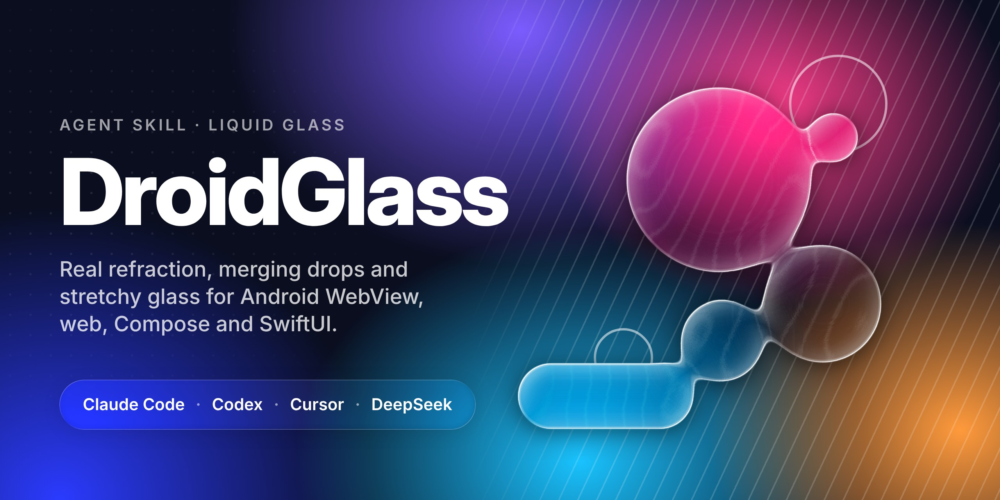

<p align="center">
  
</p>

<p align="center">
  <b>Apple-style Liquid Glass for AI coding agents.</b><br>
  One skill that teaches Claude Code, Codex, Cursor, DeepSeek Harness and other agents to build real refracting glass<br>
  on Android WebView and the web, with Jetpack Compose and SwiftUI covered too.
</p>

<p align="center">
  <a href="https://roolzksd.github.io/DroidGlass/assets/demo.html"><b>Live playground</b></a> ·
  <a href="#install">Install</a> ·
  <a href="#what-you-get">What you get</a> ·
  <a href="SKILL.md">SKILL.md</a>
</p>

<p align="center">
  
  
  
</p>

---

Ask an agent for "liquid glass" and you usually get glassmorphism: a white haze and `blur(10px)`. It looks matte and cheap. DroidGlass gives the agent a tested engine and the rules Apple's material actually follows, so the result **bends the backdrop** at the rim like a thick lens, catches a hairline highlight, splits a soft rainbow in the corners, and moves on springs.

## What you get

- **Real refraction on the web and in Android WebView.** Displacement maps computed from the same formulas as Kyant's Backdrop shader, applied through `backdrop-filter` with SVG filters. Lens, depth, dispersion, specular rim, inner and outer shadows.
- **Merging glass**, like SwiftUI's `GlassEffectContainer`: nearby shapes melt into one drop with a smooth bridge and split again. One filter for the whole group, tuned to stay cheap on phones.
- **iOS 26 interaction.** Buttons stretch toward the finger on a rubber band and bounce back, thumbs inflate into lenses and stretch at speed, the tab bar drop magnifies its item and shows neighbours at its rim. Menus grow out of their button as one drop and are picked with a single hold, slide and lift, on springs measured from UIKit.
- **Ready components:** button, toggle, slider, tab bar, magnifier, pull-down and pop-up menus with sub-menus, merge groups. Keyboard and ARIA roles included; respects reduced transparency, contrast and motion.
- **Fast startup:** `hold()` / `release()` paints text first and builds glass a frame later; a splash recipe that never stutters.
- **Graceful fallback:** Safari and Firefox get a soft blur with the same highlights, shadows and springs instead of a broken hole.
- **Jetpack Compose:** how to use Kyant's Backdrop library correctly, with recipe values from its catalog.
- **SwiftUI, UIKit, AppKit, widgets:** the real system `glassEffect`, containers, unions, transitions and the rules that keep it looking native.
- **A checklist and a troubleshooting table**, so the agent checks its own screenshots before handing the work over.

The [live playground](https://roolzksd.github.io/DroidGlass/assets/demo.html) runs every component full screen over switchable backdrops, with a lens lab that turns sliders into copy-ready `LiquidGlass.attach` code and a merge lab for drops you can drag into each other, and glass menus to hold and slide through. Best in Chrome or Edge.

Zero dependencies, no build step: three plain files (about 115 KB unminified) the agent copies into your project.

## Install

DroidGlass follows the open [Agent Skills](https://agentskills.io) format: a folder with a `SKILL.md`. Clone it into the skills folder of your agent and name the folder `droidglass`.

**Any agent, one command** (uses the [`skills`](https://github.com/vercel-labs/skills) CLI, Node 22+):

```bash
npx skills add roolzksd/DroidGlass
```

**Claude Code**

```bash
# for all your projects
git clone https://github.com/roolzksd/DroidGlass ~/.claude/skills/droidglass
# or for one project
git clone https://github.com/roolzksd/DroidGlass .claude/skills/droidglass
```

**Codex**

```bash
git clone https://github.com/roolzksd/DroidGlass ~/.agents/skills/droidglass
# or inside a repository: .agents/skills/droidglass
```

**Cursor**

```bash
git clone https://github.com/roolzksd/DroidGlass .cursor/skills/droidglass
# Cursor also reads .agents/skills, .claude/skills and .codex/skills
```

**DeepSeek Harness**

```bash
git clone https://github.com/roolzksd/DroidGlass .dsh/skills/droidglass
# or the shared folder: .agents/skills/droidglass
```

**Other agents** that support the Agent Skills format: put the `droidglass` folder wherever that agent loads skills from (many read `.agents/skills`), or let `npx skills add` do it. Restart the agent after installing.

## Use

The skill triggers by itself when you ask for glass. For example:

- "Make the bottom bar and the add button liquid glass, like iOS 26."
- "Our Capacitor app needs glass toggles and a slider that feel like Apple's."
- "Add merging glass buttons to this toolbar."
- "Give the ••• button a glass dropdown menu like in iOS 26."
- "Redo this Compose screen's bottom tabs with Liquid Glass."
- "Make this SwiftUI toolbar use the new glass, with the buttons merging when they get close."

## Platform support

| Platform | What the skill uses | Refraction |
|---|---|---|
| Android WebView, Capacitor, Cordova | DroidGlass engine | full |
| Chrome, Edge, Samsung Internet, Electron | DroidGlass engine | full |
| Safari, Firefox, any browser on iOS | DroidGlass engine, fallback mode | soft blur, same highlights and motion |
| Jetpack Compose / Compose Multiplatform | [Backdrop](https://github.com/Kyant0/AndroidLiquidGlass) by Kyant | full on Android 13+ |
| SwiftUI, UIKit, AppKit (iOS / macOS 26+) | system `glassEffect` | real material |
| React Native, Flutter | guidance: WebView layer, native module or shader port | depends |

## What's inside

```
SKILL.md                      entry point the agent reads first: workflow, Apple's rules, recipes, checklist
references/
  web.md                      how the engine works, every option, components, menus, merging, startup
  troubleshooting.md          symptom → fix table
  performance.md              why SVG filters get slow on phones and how to count it
  math-and-motion.md          lens, dispersion, highlight math; springs and gestures
  android-compose.md          Backdrop library usage
  apple.md                    SwiftUI, UIKit, AppKit, widgets
assets/
  liquid-glass.js             glass engine (window.LiquidGlass)
  liquid-glass.css            base and component styles
  liquid-ui.js                springs, gestures, components (window.LiquidUI)
  demo.html                   live playground: every component, lens and merge labs
media/
  hero.jpg, hero.html         the banner above, rendered by the engine itself
```

## Engine in 20 lines

```html
<link rel="stylesheet" href="liquid-glass.css">
<button id="buy">Buy</button>
<nav id="tabs" style="position: fixed; left: 16px; right: 16px; bottom: 16px"></nav>
<script src="liquid-glass.js"></script>
<script src="liquid-ui.js"></script>
<script>
  LiquidUI.button(document.getElementById('buy'), { tint: '#0088FF' });
  const tabs = LiquidUI.tabs(document.getElementById('tabs'), {
    items: [{ label: 'Home', icon: '<svg>…</svg>' }, { label: 'Search', icon: '<svg>…</svg>' }],
  });
  // bare glass on your own element
  LiquidGlass.attach(document.getElementById('panel'), {
    radius: 28, blur: 8, refractionHeight: 24, refractionAmount: 24, surface: 'rgb(250 250 250 / .4)',
  });
</script>
```

The banner at the top is not a mock-up: it is `media/hero.html`, a page that uses `LiquidGlass.group` with five shapes, screenshotted in Chrome.

## Honest limits

- The real material exists only on Apple platforms 26+. Everything else, including this engine, is an imitation in its style.
- SVG filters inside `backdrop-filter` work only in Chromium. Elsewhere you get the fallback.
- Keep it to about three large glass elements per phone screen. Check on a real Android device; headless browsers do not show jank.

## Credits

- [Kyant0/AndroidLiquidGlass](https://github.com/Kyant0/AndroidLiquidGlass) (Apache-2.0): Backdrop library and catalog. The web engine ports its lens, dispersion, highlight and shadow formulas and its spring constants.
- [iyinchao/liquid-glass-studio](https://github.com/iyinchao/liquid-glass-studio) (MIT): the merging scheme behind `LiquidGlass.group`.
- [facebook/astryx](https://github.com/facebook/astryx) (MIT): UIKit springs and gesture thresholds for menus, measured on iOS 26.2.
- kube.io, "Liquid Glass in the Browser": refraction through `feDisplacementMap` in `backdrop-filter`.
- Apple Human Interface Guidelines and WWDC25 "Meet Liquid Glass".

Apple, iOS, macOS and SwiftUI are trademarks of Apple Inc. This project is not affiliated with or endorsed by Apple.

## License

[Apache-2.0](LICENSE). See [NOTICE](NOTICE) for attributions.
